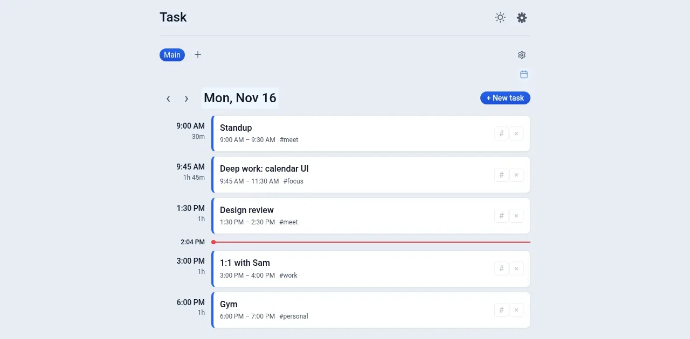

# Task

Task is a small, portable task manager, live at
[hadoku.me/task](https://hadoku.me/task/) and installable as a micro-frontend
in any other app. Type a title and press Enter; organize with `#tags`; drag a
task to reorder it or move it to another board. Anyone can use a board from
the browser alone — it lives in `localStorage` and never reaches a server.

Signing in with a hadoku.me account turns a board into a synced one: it is
kept on the server, and it can be shared with another person or scheduled
on a calendar. Higher tiers unlock more: wife tier and up can run counters,
friend tier and up can link a board to a GitHub repo, and an agent can
drive a board over MCP with no extra tier needed.

It also ships two ways to reach the same tasks without the web page: an
Android app, and a plugin for the [Kate](https://kate-editor.org/) text
editor.

- [Features](features.md): what each part does and how to use it.
- [Contributing](contributing.md): running it locally, how it is built, how it deploys.
- [History](history.md): from a plain web app to a Worker, an automation workflow and an editor plugin.
- [Trivia](trivia.md)

## Trivia

The Kate plugin went from an embedding spike to a live Tasks tab to a live
Calendar tab, and the task API grew its MCP server for agents, all in one
afternoon ([history](history.md#one-afternoon-the-kate-plugin-and-mcp-2026-06-06)).
